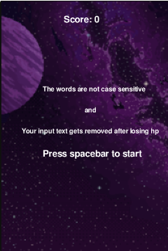
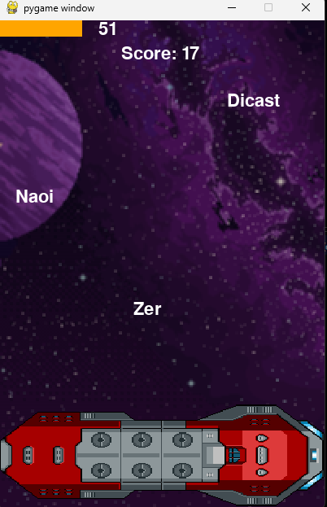
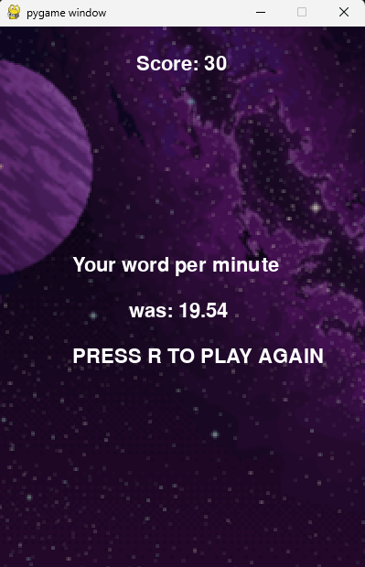

# word-shoot
My second pygame game where you shoot words

It's a wordshooting game where you type one of the words shown on screen to shoot them, it starts with 1 word then 2 words after a certain score and 3 words after another certain word. It can also be used as a way to see your typing speed along with accuracy(One mistake and you start missing words a lot more often). Since I havent made much pygame project , its kinda sloppy 

>Used pygame to make this

AI USAGE:
>Used google overview for syntax
>Claude for debugging sometimes
>Learning the input thing

Access:
Just go to https://shimes.itch.io/word-shoot and play it online
>It might take some time to load in itch please be patient :)

SCREENSHOTS:

ASSESTS USED:
    words list from https://github.com/dwyl/english-words/blob/master/words_alpha.txt
    background image from https://shiroze.itch.io/starry-night-parallax-background
    ship image from https://zintoki.itch.io/space-breaker
    background music from https://dos88.itch.io/dos-88-music-library
